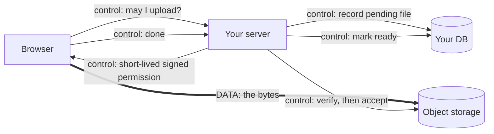

# 01 What Object Storage Is and Why It Exists

Reading route: **1 of 8** · ~20 min · next → [[02 How S3 Became the Convention]] · hub: [[_ Object Storage Hub]]

**Main sources**
- [Haystack: Facebook's photo storage (OSDI 2010, PDF)](https://www.usenix.org/events/osdi10/tech/full_papers/Beaver.pdf)
- [NASD abstract (CMU, ASPLOS 1998)](https://pdl.cmu.edu/PDL-FTP/NASD/asplos98_abs.shtml)
- [Amazon S3 launch press release (2006-03-14)](https://press.aboutamazon.com/2006/3/amazon-web-services-launches)
- [Vogels: Diving Deep on S3 Consistency (2021)](https://www.allthingsdistributed.com/2021/04/s3-strong-consistency.html)
- [AWS: presigned URLs](https://docs.aws.amazon.com/AmazonS3/latest/userguide/using-presigned-url.html) · [AWS API: Object (ETag)](https://docs.aws.amazon.com/AmazonS3/latest/API/API_Object.html) · [AWS API: ListObjectsV2](https://docs.aws.amazon.com/AmazonS3/latest/API/API_ListObjectsV2.html)

> [!summary] The idea in one breath
> Object storage is a huge, durable **key → bytes** store that you talk to over HTTP. In the ordinary buckets web apps use, it drops most filesystem features (editing in place, real directories, locks) so it can store practically unlimited files cheaply and serve them over the internet. Your app keeps the *meaning* of each file in its database. The object store keeps the bytes.

---

## The mental model

Four ideas do most of the work:

- **Bucket**: a named container, roughly one storage namespace. Typically one per app per environment.
- **Object**: the stored thing, meaning the file's bytes plus a little metadata: size, `Content-Type`, optional custom headers, and an **ETag**. The ETag (entity tag) changes when the content changes, so it's useful for comparisons and conditional requests. It's **not** a reliable checksum: AWS documents that it's an MD5 of the data only for some single-part uploads, not for multipart uploads or some encryption modes ([AWS API: Object](https://docs.aws.amazon.com/AmazonS3/latest/API/API_Object.html)). For integrity checks, use the explicit checksum fields instead.
- **Key**: the object's name inside the bucket, a plain string like `files/42/01J9ZK3`. The slashes look like folders but aren't. In a standard bucket the namespace is flat, and "folders" are just shared prefixes that tools display as a tree.
- **A small set of API operations over HTTP**: `PutObject` (an HTTP `PUT`), `GetObject` (`GET`), `HeadObject` (`HEAD`, metadata only), `DeleteObject` (`DELETE`), and `ListObjectsV2`, which is a `GET` on the bucket with query parameters that returns up to 1,000 keys per page ([AWS API](https://docs.aws.amazon.com/AmazonS3/latest/API/API_ListObjectsV2.html)). That covers most of what a web app uses.

Two consequences trip people up early:

1. **Writes replace whole objects.** With the ordinary upload APIs you can't edit the middle of an object the way you can a file. Writing to an existing key replaces it, and AWS states that this is true for presigned uploads too ([AWS](https://docs.aws.amazon.com/AmazonS3/latest/userguide/PresignedUrlUploadObject.html)).[^append]
2. **The store isn't your index.** Listing goes by key prefix, a page at a time. Queries like "all photos for user 42 from this week, newest first" belong in your database.

[^append]: Specialized variants exist. AWS's S3 Express One Zone *directory buckets*, for example, support appending to existing objects ([AWS](https://docs.aws.amazon.com/AmazonS3/latest/userguide/directory-buckets-objects-append.html)). These notes stick to the ordinary general-purpose buckets that web uploads normally use.

Compare it with the two things you already know:

| | Filesystem | Database | Object store (general-purpose bucket) |
|---|---|---|---|
| Unit | file in a directory tree | row | whole object under a key |
| Edit in place | yes | yes (per field) | no; replace the object |
| Query | walk directories | rich queries, transactions | list by prefix, page by page |
| Scale and cost | one machine or NAS | expensive per GB | practically unlimited, cheap per GB |
| Access | OS calls | DB protocol | **HTTP**, so browsers and CDNs can talk to it |

That last row is why object storage fits the web so well.

## Why it exists: two old lessons

### Lesson 1: filesystem features cost a lot at scale (Haystack)

Facebook's 2010 Haystack paper is the clearest firsthand account of why web companies moved away from storing each photo as a file on a filesystem. By then Facebook held over 260 billion images (more than 20 PB), took in roughly a billion new photos a week, and served over a million images a second at peak ([Haystack](https://www.usenix.org/events/osdi10/tech/full_papers/Beaver.pdf)).

The bytes weren't the bottleneck; the filesystem's *metadata* was. Reading one photo from their NAS setup took several disk operations: translate the filename, read the inode, then read the data. Large directories made it worse, at first more than ten operations per image and around three after tuning. Most of that per-file metadata (permissions and so on) was never used.

Their description of the workload fits most user uploads on most web apps: data is ["written once, read often, never modified, and rarely deleted"](https://www.usenix.org/events/osdi10/tech/full_papers/Beaver.pdf). If files never change, you don't need in-place edits, locks or directories. You need "put it, keep it safe, give it back fast". That stripped-down contract is what object storage offers.

### Lesson 2: keep servers off the data path (NASD)

Earlier still, CMU's 1998 NASD research ("Network-Attached Secure Disks") argued against paying for servers whose main job is shuffling data between disks and clients. Two of its four principles were direct transfer to clients and cryptographically secured interfaces ([NASD abstract](https://pdl.cmu.edu/PDL-FTP/NASD/asplos98_abs.shtml)).

> [!note] Interpretation
> That pairing is the conceptual ancestor of today's **presigned URL**. A trusted party grants a narrow, cryptographically checked permission, and the bytes move directly between client and storage. The NASD abstract doesn't mention S3, which came later; the connection is my reading.

### Then S3 made it a utility (2006)

Amazon launched S3 as internet-wide storage with a deliberately small feature set, billed per GB stored and transferred with no minimum ([press release](https://press.aboutamazon.com/2006/3/amazon-web-services-launches)). Object storage existed before S3, in research and in enterprise products. S3 turned it into a pay-as-you-go web service. How that became the default is covered in [[02 How S3 Became the Convention]].

## The properties worth understanding

### Durability vs availability (separate promises)

- **Durability** is about not losing data. Providers keep copies, or erasure-coded fragments (a way to rebuild data from partial pieces, cheaper than full copies), spread across many disks and facilities. AWS says S3 is *designed* for eleven nines of durability ([S3 FAQ](https://aws.amazon.com/s3/faqs/)). That's an engineering target, not an absolute guarantee, and it does nothing for data *you* delete or overwrite by mistake.
- **Availability** is about whether you can reach the data right now. S3's original design target was 99.99% ([press release](https://press.aboutamazon.com/2006/3/amazon-web-services-launches)).

These fail independently. In AWS's [February 2017 us-east-1 incident](https://aws.amazon.com/message/41926/), a mistyped command removed too much capacity and S3 in that region couldn't serve requests for about four hours. AWS's write-up describes an availability failure, not lost data. That's the usual shape of a storage outage, but it isn't a law: data loss is a separate failure mode that durability engineering makes rare, not impossible. For your own app, protect against the far likelier risk of a bug or a person deleting things ([[04 Browser Uploads in Practice]] §12).

### Consistency (whether a read sees the latest write)

*Consistency* is whether a read issued right after a write sees that write. S3 was originally **eventually consistent**, meaning a new object could briefly be missing from GET or LIST results. Werner Vogels later explained that this was acceptable for 2006 workloads like website images and backups. Larger users built workarounds, though (Netflix's s3mper, Hadoop's S3Guard). Since **December 2020**, S3 provides strong read-after-write consistency for GETs, PUTs and LISTs ([AWS announcement](https://aws.amazon.com/about-aws/whats-new/2020/12/amazon-s3-now-delivers-strong-read-after-write-consistency-automatically-for-all-applications), [Vogels](https://www.allthingsdistributed.com/2021/04/s3-strong-consistency.html)).

Know what this does and doesn't cover:
- It covers **direct storage API calls after a successful write**. Your finalize step can `HEAD` a just-uploaded object and see it ([[04 Browser Uploads in Practice]]).
- It doesn't make a **CDN cache** fresh. A cached copy can outlive an overwrite or delete.
- It doesn't make "write the object + update the DB row" **atomic**, and it doesn't give you **multi-object transactions**.
- Other providers state their own guarantees. Check them rather than assuming S3's.

### Big objects come in parts

A 20 GB video isn't going to arrive in one request over a flaky connection. **Multipart upload** splits an object into parts (5 MiB to 5 GiB each, up to 10,000 parts) that upload and retry independently before S3 assembles them. AWS suggests considering it from about 100 MB. The maximum object size is now listed as 48.8 TiB ([AWS limits](https://docs.aws.amazon.com/AmazonS3/latest/userguide/qfacts.html)), raised from 5 TB in [December 2025](https://aws.amazon.com/about-aws/whats-new/2025/12/amazon-s3-maximum-object-size-50-tb/).

## The cost model: three meters

Most providers bill some mix of:

1. **Storage**: GB stored per month. AWS reported S3 at a little over 2 US cents per GB in March 2026 ([AWS](https://aws.amazon.com/blogs/aws/aws-weekly-roundup-amazon-s3-turns-20-amazon-route-53-global-resolver-general-availability-and-more-march-16-2026/)). Cloudflare R2 lists $0.015 per GB-month ([R2 pricing, updated 2026-10-01](https://developers.cloudflare.com/r2/pricing/)).
2. **Requests**: per thousand or million operations. Writes and lists usually cost more than reads.
3. **Egress**: bytes sent *out* to the internet, which happens whenever someone downloads or views a file. AWS includes 100 GB/month of internet egress free across services ([S3 pricing page](https://aws.amazon.com/s3/pricing/)) and charges per GB after that. The per-GB table didn't render for me, so check the calculator. R2 lists egress as free ([R2 pricing](https://developers.cloudflare.com/r2/pricing/)).

> [!note] Interpretation
> For a small web app, storage is rarely the scary line on the bill. **Egress** is, because it scales with *traffic*, including bots and hotlinking, not with what you chose to store. That's why zero-egress pricing became a competitive weapon in 2021 ([[02 How S3 Became the Convention]]).

A related trap is paying for requests you didn't make. In 2024 a developer was billed for about 100 million *unauthorized* PUTs that strangers' misconfigured tools sent to his bucket ([Simon Willison's write-up](https://simonwillison.net/2024/Apr/30/how-an-empty-s3-bucket-can-make-your-aws-bill-explode)). AWS then stopped charging for 403 responses to requests from outside your account or organization ([AWS, 2024-08-19](https://aws.amazon.com/about-aws/whats-new/2024/08/amazon-s3-no-charges-several-http-error-codes)). Authorized traffic still costs money, including your own users, so set billing alerts. They warn you; they don't cap spending.

## The central idea for web apps: two paths

Every file feature has two separate flows. Good designs keep them apart:

- **Control path**: *who* may do *what*, and what it *means*. That covers authenticating the user, deciding they may upload a 10 MB avatar, and recording "user 42's avatar is object `files/42/01J9…`". It runs through **your server and database**.
- **Data path**: the actual **bytes**. Ideally they go directly between the **browser and storage** (or a CDN in front of it), without passing through your server.

Why separate them? Moving bytes is the expensive, slow part (bandwidth, memory, timeouts), and it's exactly what storage providers are built for. Serverless platforms make the point concrete: a Vercel Function rejects request bodies over 4.5 MB ([Vercel limits](https://vercel.com/docs/functions/limitations)), so even a phone photo can be too big to pass through one.

The bridge between the two paths is the **presigned URL**: a URL that carries a signature your server computed with its credentials, scoped to one operation (say, `PUT`) on one key until an expiry time. Storage checks the signature and allows the request. Per AWS's docs, whoever holds the URL can use it, and it can be reused until it expires ([AWS](https://docs.aws.amazon.com/AmazonS3/latest/userguide/using-presigned-url.html)). It isn't single-use. It also doesn't know who your user is, doesn't inspect the file, and doesn't tell your app the upload finished. Those jobs, and the subtle problems they create, are the subject of [[04 Browser Uploads in Practice]].

## Identity: key vs URL vs database record

This sounds pedantic, but it saves real pain:

- **Key**: the file's identity inside a bucket (`files/42/01J9ZK3`).
- **URL**: *one way to reach it today*. It changes when you put a CDN in front, switch to signed URLs for privacy, or move providers. UploadThing's own docs warn against relying on raw storage URLs for the same reason ([docs](https://docs.uploadthing.com/working-with-files)).
- **DB record**: the meaning. That's the owner, purpose (avatar, invoice), status (pending, ready, deleted), original filename, and verified size and type.

**Store the key (and which bucket or provider) in your DB, and build URLs when you need them.** Keep the user's original filename in the DB, not in the key.

## What object storage does *not* do for you

On its own, a bucket won't:

- decide which of *your* users may read or write which file (that's authorization, your app's job),
- check that `photo.jpg` is really a JPEG (it stores whatever bytes arrive),
- make thumbnails or prepare video for smooth playback ([[05 Photos, Documents and Video]]),
- keep your database and bucket in sync, or keep CDN caches fresh,
- protect you from your own bug, or a coding agent, deleting things (unless you set up versioning or backups).

Most "S3 is hard" complaints are about this list, not about storing bytes.

## Takeaways
- Object storage is durable key → bytes over HTTP. It's cheap because general-purpose buckets drop filesystem features that most web files don't need.
- Keep the **control path** (your server + DB) separate from the **data path** (browser ↔ storage or CDN). Presigned URLs bridge them. They're reusable bearer permissions, not proof of identity or content.
- Store **keys**, not URLs, and keep meaning in your DB.
- Watch **egress** and request costs more than storage. Alerts warn, they don't cap.
- Durability and availability are different promises. Outages usually mean "can't reach it", not "lost it", but plan for your own mistakes either way.

Next: [[02 How S3 Became the Convention]]
