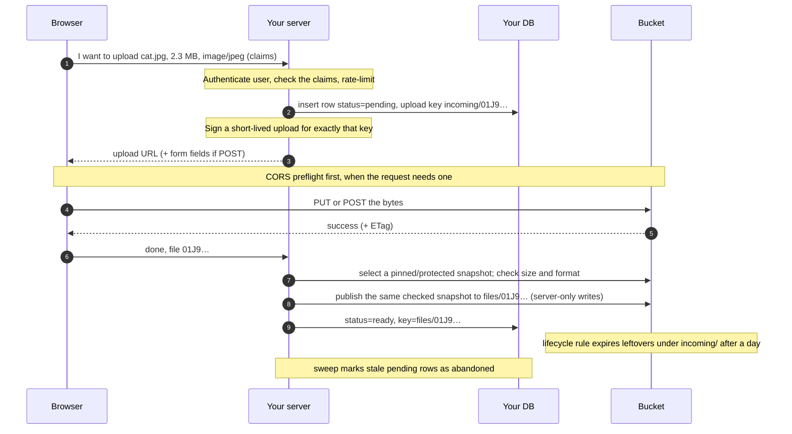

# 04 Browser Uploads in Practice

Reading route: **4 of 8** · ~35 min · prev ← [[03 What Big Tech Does and What a Solo Dev Should Copy]] · next → [[05 Photos, Documents and Video]] · hub: [[_ Object Storage Hub]]

**Visual companion:** [Upload flows explained (HTML)](upload-flows-explained.html) steps through the proxy flow, the direct-to-your-bucket flow and the UploadThing flow side by side, and includes a responsibility table. Keep it open alongside sections 1–4.

**Main sources**
- [AWS: versioned and conditional object copies](https://docs.aws.amazon.com/AmazonS3/latest/API/API_CopyObject.html) (snapshot-safe acceptance, checked during final review)
- [AWS: presigned URLs](https://docs.aws.amazon.com/AmazonS3/latest/userguide/using-presigned-url.html) · [AWS: uploading with presigned URLs](https://docs.aws.amazon.com/AmazonS3/latest/userguide/PresignedUrlUploadObject.html) · [Boto3: generate_presigned_post (POST policy fields and conditions)](https://docs.aws.amazon.com/boto3/latest/reference/services/s3/client/generate_presigned_post.html)
- [AWS: CORS](https://docs.aws.amazon.com/AmazonS3/latest/userguide/cors.html) · [AWS: multipart limits](https://docs.aws.amazon.com/AmazonS3/latest/userguide/qfacts.html) · [AWS: abort incomplete multipart uploads](https://docs.aws.amazon.com/AmazonS3/latest/userguide/mpu-abort-incomplete-mpu-lifecycle-config.html) · [AWS: conditional writes](https://aws.amazon.com/about-aws/whats-new/2024/08/amazon-s3-conditional-writes)
- [Cloudflare R2: presigned URLs](https://developers.cloudflare.com/r2/api/s3/presigned-urls/) · [OWASP File Upload Cheat Sheet](https://cheatsheetseries.owasp.org/cheatsheets/File_Upload_Cheat_Sheet.html) · [Rails Active Storage guide](https://guides.rubyonrails.org/active_storage_overview.html) (a mature framework's answers to the same problems)

> [!info] Assumed setup
> A generic TypeScript web monorepo: a web app (Next.js or similar), an API layer, a SQL database, deployed serverless or on a small long-running server. Numbers like "10 minutes" or "100 MB" below are **illustrative defaults**. I explain the reasoning behind each so you can choose your own.

> [!summary] The pattern in one line
> **Ask → authorize → record "pending" → sign for one exact key → browser uploads directly → finalize (verify) → accept → mark "ready" → clean up whatever never finished.** Each section below explains one of those words.

---

## 1. Option A: proxy the bytes through your server

The browser sends the file to *your* endpoint. Your server checks it and writes it to storage with the storage SDK.

**What it avoids:** the browser never talks to storage, so there's no bucket CORS and no presigned-URL choreography. Your server still authenticates its own storage requests (the SDK signs them with its credentials). If your API lives on a different origin from your web app, the *API* needs CORS like any cross-origin API.

**What's good about it:** your server sees the actual bytes, so it can check size and real format before anything is stored, and the stored bytes are exactly the ones it checked.

**What it costs:** every byte crosses your server, using bandwidth, memory and time. On serverless it often just fails: Vercel Functions reject request bodies above 4.5 MB with a `413` error ([Vercel](https://vercel.com/docs/functions/limitations)). It isn't free of cleanup either. If the storage write succeeds and the DB write then fails, you have an orphaned object.

**When it fits:** small files on a long-running server, files your server generates itself (PDF invoices, exports), admin tools, and imports from a URL.

## 2. Option B: direct upload with a signed permission (the usual default for user uploads)

The incoming upload stream goes directly to storage. Your server still reads bytes for validation or processing when needed; a storage-side copy can avoid downloading the whole object. This preserves the control path / data path split from [[01 What Object Storage Is and Why It Exists]]. Section 4 explains the extra "accept" step.

### What a presigned URL is, mechanically
Your server computes a signature (an HMAC, a keyed hash) over the method, bucket, key, expiry and any headers you choose to include, using its storage credentials. Storage recomputes the signature and allows the request if it matches. The signing itself is local computation with no round trip to storage. Getting or refreshing the *credentials* may involve a network call, though.

**Which credentials:** on AWS, prefer temporary role-based credentials whose permissions are limited to this bucket and prefix, over a long-lived access key. One side effect: a URL signed with temporary credentials stops working when those credentials expire, even if the URL's own expiry is later ([AWS](https://docs.aws.amazon.com/AmazonS3/latest/userguide/using-presigned-url.html)). On other providers, use the narrowest API token they offer.

What AWS documents about using the URL ([AWS](https://docs.aws.amazon.com/AmazonS3/latest/userguide/using-presigned-url.html), [AWS](https://docs.aws.amazon.com/AmazonS3/latest/userguide/PresignedUrlUploadObject.html)):
- Presigned URLs are **bearer tokens**: anyone holding one can use it.
- They're **reusable** until they expire, not single-use. Maximum lifetime is 7 days with long-lived keys, and shorter with temporary credentials.
- Uploading to a key that already exists **replaces** the object.
- A signed `Content-Type` must be sent exactly as signed, or the request fails. That pins the *declared* type. It doesn't prove the file's format.

> [!warning] What a presigned URL is *not*
> It isn't user authentication: your server decides *before* signing whether this user may upload this file. It isn't content validation: storage accepts whatever bytes arrive. And it isn't a completion signal: storage doesn't tell your app the upload happened.

## 3. Presigned PUT vs presigned POST, and why to sign one exact key

| | Presigned **PUT** | Presigned **POST** (POST policy) |
|---|---|---|
| Request shape | Raw bytes as the request body | HTML-form-style `multipart/form-data`: policy fields plus the file |
| What you can constrain | The exact key, expiry, and any headers you sign (e.g. `Content-Type`) | The key, plus **conditions** such as a size range (`content-length-range`) or a value prefix. Boto3's reference distinguishes the *fields* you prefill from the *conditions* storage enforces ([Boto3](https://docs.aws.amazon.com/boto3/latest/reference/services/s3/client/generate_presigned_post.html)) |
| Size limit | No size range. Check the real size at finalize. | Enforced by storage via `content-length-range` |
| Provider support (as documented) | Broad. R2 presigns GET/HEAD/PUT/DELETE. | AWS; Ceph and Garage per [Garage's table](https://garagehq.deuxfleurs.fr/documentation/reference-manual/s3-compatibility/). **Not R2** ([R2](https://developers.cloudflare.com/r2/api/s3/presigned-urls/)), nor Swift or Riak CS per Garage. |

A classic mistake is adding a `content-length-range` condition and then uploading with PUT. Policy conditions apply only to POST uploads ([Fly.io community thread, 2025](https://community.fly.io/t/content-length-range-doesnt-limit-file-upload/25260)).

**Sign the exact key that matches your pending DB row.** A POST policy *can* allow any key under a prefix (`starts-with`), but then one signature lets the browser create objects you never recorded. Use prefix scope only if you deliberately want that broader permission.

> [!tip] Recommendation
> Sign one exact, server-generated key. On AWS, a POST with `content-length-range` adds a size limit that storage enforces. On R2, use PUT and enforce size at finalize. Either way, **verify at finalize**, the one check that looks at what was actually stored, and then deal with the reuse problem in §4.

## 4. The reusable-URL problem: bytes can change after you checked them

This is the subtle one. Your finalize step checks the object, then marks it ready. But the presigned URL **stays valid until it expires**. Whoever holds it (your user, or anyone they share it with) can upload *different* bytes to the same key *after* your checks passed. Your DB then says "verified JPEG" about something that no longer is. Random keys don't prevent this. They make keys unguessable, not immutable. Engineers call this a time-of-check/time-of-use gap.

Proportional ways to close or narrow it:

1. **Short expiry** (minutes) narrows the window. It doesn't close it.
2. **Create-only writes.** S3 supports `If-None-Match: *` on `PutObject` ([AWS](https://aws.amazon.com/about-aws/whats-new/2024/08/amazon-s3-conditional-writes)), and R2 evaluates conditional `PutObject` atomically ([R2](https://developers.cloudflare.com/r2/api/s3/api/)). This only protects you if your *presigned upload request* actually carries the header and storage enforces it, so test that with your SDK and provider. Don't assume a POST policy gives you the same behavior.
3. **Pin the content.** AWS's SigV4 presigned uploads accept checksum headers ([AWS](https://docs.aws.amazon.com/AmazonS3/latest/userguide/using-presigned-url.html)). If the expected checksum is part of what you sign, storage should reject different bytes. The catch is that the browser has to hash the file *before* asking for the URL. Verify the behavior on your provider.
4. **Accept into a separate key (my default for user content).** The browser only ever writes to an *upload* key like `incoming/01J9…`. Your server selects or protects one snapshot, validates it, then publishes those same bytes (or their validated image derivative) to an *accepted* key like `files/01J9…` that the browser cannot write. The DB points only at the accepted key, and a lifecycle rule expires leftovers under `incoming/`.

> [!important] Publish the same snapshot you checked
> Checking a mutable key and then copying its latest contents still races with another upload. Bind reads and copying to one source `versionId`, or use conditional reads and `CopySourceIfMatch` against the checked ETag, retrying validation on a mismatch. Another option is to copy into a private server-controlled candidate first, validate that candidate, then publish it. A transform must use the bytes it checked. AWS documents [versioned and conditional copying](https://docs.aws.amazon.com/AmazonS3/latest/API/API_CopyObject.html); other providers need equivalent guarantees. Keep staging and candidates private until acceptance.

Option 4 adds copy or transformation work, requests and temporary storage; very large copies may require multipart copying. It prevents later client overwrites of the accepted key when publication preserves the checked snapshot. It also gives image processing and cleanup a clear place. For large videos, options 2–3 or a video platform ([[05 Photos, Documents and Video]]) may suit better.

## 5. CORS: the browser's permission slip

The browser enforces the *same-origin policy*: JavaScript from `app.example.com` can't read responses from your bucket's origin unless the bucket's CORS rules allow it. For many requests (PUT with a `Content-Type`, custom headers), the browser first sends a **preflight** `OPTIONS` request asking permission. Some simple form-style POSTs don't need one.

A bucket CORS rule lists ([AWS](https://docs.aws.amazon.com/AmazonS3/latest/userguide/cors.html)):
- `AllowedOrigins`: your real app origins (production and your dev URL), not `*` for uploads.
- `AllowedMethods`: `PUT` or `POST` for uploads, `GET` if browser code fetches files.
- `AllowedHeaders`: e.g. `Content-Type` and any checksum or conditional headers you send.
- `ExposeHeaders`: e.g. `ETag`, if browser code must read it (needed for browser-driven multipart).

Two clarifications:
- **CORS isn't authorization.** It only governs what browsers let pages read, and non-browser clients ignore it. AWS notes that bucket permissions still apply with CORS enabled. What actually limits uploads is your server's decision to sign, the scope of what it signs, and the expiry.
- When an upload fails in the browser with a vague network error but works from `curl`, CORS is a good first thing to check. It isn't the only possible cause.

## 6. Finalize: the step tutorials skip

The browser might crash, lose its connection, upload something unexpected, or never call back, and storage doesn't notify your app by default. So:

1. The browser calls `POST /files/:id/complete`.
2. Your server checks the row belongs to this user and is `pending`.
3. Select the pinned/protected snapshot described in §4 and `HEAD` it. That tells you it **exists**, its **size**, and its stored metadata. The stored `Content-Type` is just what the client declared. On S3, this check is reliable immediately after upload thanks to strong consistency ([[01 What Object Storage Is and Why It Exists]]).
4. Check the **format**: read the first few KB (a ranged `GET`) and check the file signature ("magic bytes", the leading bytes that identify formats like PDF or JPEG). For images, decoding and re-encoding is a stronger check.
5. **Accept that same snapshot** (§4) and mark `ready`, or delete the upload and mark the row `rejected`. Make this idempotent: after checking ownership, if the row is already `ready`, return success.

**Alternative:** bucket event notifications, where storage calls a webhook or queue when an object lands. That's more infrastructure, worth it when the client can't be trusted to call back or processing is heavy. Managed services such as UploadThing send this callback for you ([[06 UploadThing - What It Actually Is]]). Theo names "how do you know the upload finished?" as a core S3 pain point ([Mux interview, 2024](https://mux.com/blog/theobrowne)).

## 7. Keeping the database and the bucket in sync

You have two systems and **no transaction spanning them**, so expect them to drift and design for it:

- **The DB decides what's attached.** Use explicit states, such as `pending` → `ready`, `rejected`, or `deleting` → `deleted`. An object can legitimately exist without a `ready` row while it's still pending or being processed. Grace periods and lifecycle rules decide when it becomes garbage.
- **Create the row first.** Every key you sign is then traceable.
- **Abandoned uploads happen.** With the incoming/accepted split, a lifecycle rule expires stale upload objects automatically. A scheduled sweep marks old `pending` rows as abandoned. Rails ships the same idea: its guide treats uploads that never get attached as normal and suggests periodically purging them ([Rails guide](https://guides.rubyonrails.org/active_storage_overview.html)). A mature framework treating this as routine tells you it's expected, not a sign you did something wrong.
- **Abandoned multipart uploads** cost storage until aborted. Add AWS's recommended `AbortIncompleteMultipartUpload` lifecycle rule ([AWS](https://docs.aws.amazon.com/AmazonS3/latest/userguide/mpu-abort-incomplete-mpu-lifecycle-config.html)).
- **Deleting:** mark the row `deleting`, delete the object (and its variants), then mark it `deleted`. Keep the row until deletion succeeds, so a failed delete can be retried instead of becoming an untracked object.
- **Occasional reconciliation:** a rare job can list accepted keys and compare them with the DB. Use it as a safety net, not as your index.

## 8. Retries and idempotency

*Idempotent* means "doing it twice has the same effect as once". That's what makes retries safe.
- **Server-generated keys** (random IDs such as UUIDs or ULIDs) make a retried upload target the same upload key. Before acceptance, overwriting your own staging object is harmless.
- **Finalize and accept are idempotent:** re-running them on a `ready` row is a no-op.
- **Create-only writes** (§4) stop accidental overwrites where supported.
- **Client retries** use backoff. If the URL has expired, ask the server for a new one.

## 9. Validation and abuse

> [!warning] Claims vs facts
> The **filename extension**, the browser's **`Content-Type`**, and the metadata `HEAD` returns are claims or stored labels. OWASP advises against trusting the client's content type, and treats file-signature checks as useful but easy to bypass, so never the only check ([OWASP](https://cheatsheetseries.owasp.org/cheatsheets/File_Upload_Cheat_Sheet.html)). This applies to managed services too. UploadThing's SDK matches file types on the browser-supplied MIME type, falling back to the filename, without reading the bytes ([SDK source](https://raw.githubusercontent.com/pingdotgg/uploadthing/main/packages/shared/src/utils.ts)).

Layer the checks in proportion to the risk:
- **Size:** check the claim before signing, enforce it at storage where possible (POST policy), and verify the real size at finalize. Rejecting an oversized object afterward does not undo the upload's resource use or costs.
- **Type:** allowlist by purpose (avatars: JPEG/PNG/WebP), sniff magic bytes at finalize, and re-encode images ([[05 Photos, Documents and Video]]).
- **Names:** generate keys yourself, as OWASP recommends, and keep the original filename in the DB.
- **Serving origin:** OWASP prefers serving uploads from a separate host. Serving user files from a **separate, unrelated domain** (not a subdomain that shares your app's cookies) keeps an uploaded HTML or SVG file from running script in your app's context. That's my reasoning, and an unrelated domain is stronger than a sibling subdomain. For documents, `Content-Disposition: attachment` makes browsers download rather than render. Neither makes a malicious file safe to open.
- **Quotas and rate limits:** your *authorized* users can still run up costs. Cap sign requests per user per minute, pending uploads per user and storage per account.
- **Short expiries:** minutes, not days. The right number depends on how long your largest legitimate upload takes.
- **Malware scanning:** worth it once users share documents with *other* users. AWS offers managed scanning of new S3 uploads via GuardDuty ([AWS, 2024-06-11](https://aws.amazon.com/about-aws/whats-new/2024/06/detect-malware-object-uploads-amazon-s3-guardduty)).

## 10. Private reads

Most buckets should be private; on new AWS buckets that's been the default since 2023 ([[02 How S3 Became the Convention]]). To show a private file:

1. The browser asks your app for `/files/:id`.
2. Your app checks this user may see it.
3. Your app redirects to, or returns, a **short-lived presigned GET** for the accepted key.

**A useful contrast from Rails.** Active Storage keeps the storage service private by default and redirects to short-lived storage URLs. But its guide also says its built-in controllers are **publicly accessible** by default, and the app-level blob URLs they serve use signed IDs that **don't expire**. For files that need access control, it recommends writing your own controllers ([Rails guide: authenticated controllers](https://guides.rubyonrails.org/active_storage_overview.html#authenticated-controllers)). The lesson: **a private bucket isn't the same as an authorized route.** The check in step 2 is what protects the file.

**Public files** (avatars, product images) have two clean options. Either a CDN reads from the still-private bucket through an origin-access mechanism (on AWS, CloudFront origin access control; [AWS](https://docs.aws.amazon.com/AmazonCloudFront/latest/DeveloperGuide/private-content-restricting-access-to-s3.html)), or you deliberately make a prefix publicly readable, which on AWS means relaxing Block Public Access for that bucket. A custom domain is just naming on top of either. Provider gotcha: R2 presigned URLs work on its S3 API domain but not on custom domains ([R2](https://developers.cloudflare.com/r2/api/s3/presigned-urls/)).

## 11. Large files: multipart and resumable uploads

- **Multipart** (S3 API): split the file into parts (5 MiB to 5 GiB, up to 10,000), upload them in parallel, retry failed parts, then call "complete". AWS suggests considering it from about 100 MB ([AWS](https://docs.aws.amazon.com/AmazonS3/latest/userguide/qfacts.html)). In the browser, each part needs its own presigned URL, and your server makes the create and complete calls.
- **Resumable** means picking up after a disconnect without starting over. The open **tus** protocol asks the server for its current offset, then sends the remaining bytes ([tus 1.0](https://tus.io/protocols/resumable-upload)). Cloudflare Stream requires tus for videos over 200 MB ([docs](https://developers.cloudflare.com/stream/uploading-videos/direct-creator-uploads/)), and UploadThing v7 has its own resumable mechanism ([docs](https://docs.uploadthing.com/uploading-files)).

> [!tip] Recommendation
> Skip multipart until files regularly get large enough that failed single requests annoy users (AWS's ~100 MB is a reasonable marker) or your users upload over flaky mobile networks. When you need it, use a well-known client library rather than hand-rolling part logic.

## 12. Deletion, retention and backups

- **"Delete" touches several places:** the DB row, the accepted object and its variants, any CDN caches (which can keep serving until they expire or you invalidate them), and any backups. Decide what "deleted" means for your users: gone immediately, or recoverable for 30 days?
- **Lifecycle rules** expire objects under a prefix automatically (e.g. `incoming/` after 1 day).
- **Versioning** (on AWS S3) keeps old versions when objects are overwritten or deleted. That protects against bugs, but you pay for every old version until a lifecycle rule removes it. R2 doesn't support versioning through its S3 API ([R2](https://developers.cloudflare.com/r2/api/s3/api/)).
- **Your most likely data loss** is *you*, a script, or a coding agent deleting the wrong thing, far more often than the provider losing data. Use separate buckets and credentials for dev and prod. If uploads are irreplaceable, run a periodic copy to a second bucket or provider.

## 13. Delivery cost

Every view of a public file is egress somewhere ([[01 What Object Storage Is and Why It Exists]]). To keep it predictable:
- A **CDN** can serve repeat requests from cache. Whether that lowers your bill depends on your traffic pattern and how the provider prices CDN vs storage egress. Long `Cache-Control` lifetimes are safe only when a key's content never changes, which the accepted-key pattern (§4) gives you.
- Serve **resized variants**, not originals.
- A **zero-egress provider** suits download-heavy apps (R2 lists free egress; [pricing updated 2026-10-01](https://developers.cloudflare.com/r2/pricing/)).
- Set a **billing alert** on day one. It warns; it doesn't cap.

## Proportional defaults

| Day one (any serious project) | Add when… |
|---|---|
| Private bucket; scoped (ideally temporary) credentials; separate dev/prod buckets | Public files → a CDN with origin access, or a deliberately public prefix |
| Server-generated keys; one DB row per file (`pending → ready`) | Users share documents → malware scanning |
| Short-lived upload signed for one exact key; CORS limited to your origins | Files regularly large or networks flaky → multipart/resumable |
| Finalize: `HEAD` + size check + format sniff for risky types; accept into a separate key | Processing gets slow → background job or queue after finalize |
| Lifecycle: expire `incoming/`, abort stale multipart; sweep stale pending rows | Irreplaceable data → versioning or a cross-provider copy |
| Private reads via your authorization check + short-lived presigned GET | Egress noticeable → CDN caching or a zero-egress provider |
| Per-user quotas + billing alert | Video is core → a video platform ([[05 Photos, Documents and Video]]) |

## Takeaways
- Direct upload means your server **decides and records** and the browser **moves bytes**.
- Presigned URLs are short-lived, reusable bearer permissions for one operation. Sign one exact key. They don't authenticate, validate or notify.
- Because URLs are reusable, **checked bytes can be replaced** until expiry. Accept validated content into a separate key, or use create-only or pinned-content uploads where your provider supports them.
- **Finalize, accept and sweep** are what make the system correct, more than the upload itself.
- Extensions, client MIME types and `HEAD` metadata are labels. Inspect content in proportion to the risk.

Next: [[05 Photos, Documents and Video]]
