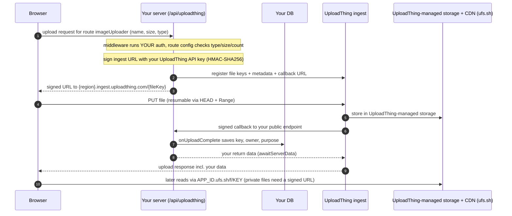

# 06 UploadThing: What It Actually Is

Reading route: **6 of 8** · ~25 min · prev ← [[05 Photos, Documents and Video]] · next → [[07 UploadThing Popularity - What the Evidence Shows]] · hub: [[_ Object Storage Hub]]

**Visual companion:** the "UploadThing v7" tab and the responsibility table in [Upload flows explained (HTML)](upload-flows-explained.html).

**Main sources** (all checked 2026-10-18)
- Docs: [uploading files](https://docs.uploadthing.com/uploading-files) · [auth & security](https://docs.uploadthing.com/concepts/auth-security) · [regions & ACL](https://docs.uploadthing.com/concepts/regions-acl) · [working with files](https://docs.uploadthing.com/working-with-files) · [UTApi](https://docs.uploadthing.com/api-reference/ut-api) · [file routes](https://docs.uploadthing.com/file-routes) · [FAQ](https://docs.uploadthing.com/faq) · [docs sitemap](https://docs.uploadthing.com/sitemap-0.xml)
- Blog: [v7 launch (2024-09-13)](https://docs.uploadthing.com/blog/v7-launch) · [outage report (2024-09-11)](https://docs.uploadthing.com/blog/incident-report-2024-09-10) · [usage-based pricing (2025-01-30)](https://docs.uploadthing.com/blog/usage-based)
- [Pricing](https://uploadthing.com/pricing) · [GitHub repo](https://github.com/pingdotgg/uploadthing) · [Mux interview with Theo (2024-11-26)](https://mux.com/blog/theobrowne)

> [!summary] The short answer
> UploadThing is a **managed file upload and hosting service** from Ping Labs, whose CEO is Theo Browne (t3.gg). Its **SDKs are open source (MIT)**. The service behind them is hosted by UploadThing, and I found **no public docs for self-hosting it or for bringing your own bucket**. That's absence of documentation, not proof it's impossible. In the documented v7 design (since Sept 2024):
> - your server signs upload URLs with your **UploadThing** API key,
> - the browser uploads to **UploadThing's ingest servers**,
> - files go to **UploadThing-managed storage** (default region AWS us-west-2), not a bucket you configure through this integration,
> - UploadThing **calls your server back** when an upload finishes,
> - files are served from **`<APP_ID>.ufs.sh`**.
>
> It removes real glue work: signing details, completion callbacks, resumable uploads, UI components, and (as currently advertised) separate bandwidth billing. Your authorization rules, database records, content checks, deletion policy, video processing and exit plan remain yours.

---

## 1. How it evolved (and why "a wrapper around S3" is out of date)

| When | What | Source |
|---|---|---|
| 2023-04/05 | npm package first published 2023-04-14; GitHub repo created 2023-05-10 | [npm registry](https://registry.npmjs.org/uploadthing), [GitHub API](https://api.github.com/repos/pingdotgg/uploadthing) |
| 2023-05-11 | A request to plug in your own S3-compatible bucket was **closed "not planned"**. The maintainer explained that the packages only touch S3 through presigned URLs, so it was an infrastructure question | [Issue #28](https://github.com/pingdotgg/uploadthing/issues/28) |
| v6 era | The docs described hosting as ["mostly just wrapping S3 with caching and callbacks"](https://v6.docs.uploadthing.com/). Flow: your server got an **S3** presigned URL via UploadThing's API, the browser uploaded to S3, an S3 event told UploadThing, UploadThing called your server, and the browser **polled** for completion | [v6 docs](https://v6.docs.uploadthing.com/), [v7 post](https://docs.uploadthing.com/blog/v7-launch) |
| 2024-09-10 | **53-minute outage**: all hosted file URLs were unreachable while files moved from one shared S3 bucket into regional S3 buckets. Cause: a URL-rewrite bug in a Cloudflare KV cache. No data lost | [Incident report](https://docs.uploadthing.com/blog/incident-report-2024-09-10) |
| 2024-09-13 | **v7**: browsers upload to UploadThing's own **ingest server**, which stores the file and calls your server. Polling removed, resumable uploads added, self-benchmarked as roughly 5x faster. Bring-your-own-bucket and transcoding listed as **possible future work** | [v7 post](https://docs.uploadthing.com/blog/v7-launch), [npm: 7.0.0 on 2024-09-13](https://registry.npmjs.org/uploadthing) |
| 2025-01-30 | Usage-based plan: $25/month including 250 GB, then $0.08/GB. Announced with no charges for seats, requests or bandwidth | [blog](https://docs.uploadthing.com/blog/usage-based) |
| 2025-05-09 | Dynamic region selection in the SDK (7.7.0) | [CHANGELOG](https://github.com/pingdotgg/uploadthing/blob/main/packages/uploadthing/CHANGELOG.md) |
| 2025-08-17 | Most recent npm release as of 2026-10-18: **7.7.4**. The GitHub repo was last pushed 2026-09-30 | [npm](https://registry.npmjs.org/uploadthing), [GitHub API](https://api.github.com/repos/pingdotgg/uploadthing) |

> [!note] Interpretation
> "A wrapper around S3", as you'd heard it described, matches the **v6** design. From v7 on, UploadThing runs its own upload servers and treats the storage behind them as an internal detail. The 2024 incident report shows regional S3 buckets behind the service at that time. The docs warn that UploadThing [may move files between providers or buckets](https://docs.uploadthing.com/working-with-files), so don't build on assumptions about which storage sits underneath. SDK release dates tell you about the client libraries, not about how actively the hosted service is run.

## 2. The v7 flow: what is signed where, and where the bytes go

Details from the [uploading files](https://docs.uploadthing.com/uploading-files) page:
- **File key:** your server creates it from an encoding of your app ID plus a random seed.
- **Signed URL:** the ingest URL carries query parameters including expiry, file name, file **size**, route and optional ACL. Your server signs it with HMAC-SHA256 using your API key. The upload fails if the file doesn't match the signed parameters, so the **signed size is enforced** at ingest.
- **Registration:** your server sends the file keys, metadata and callback URL to the ingest service.
- **Callback:** after storing the file, UploadThing calls your endpoint with a body signed by your API key, and SDKs from v6.7 verify it automatically ([auth & security](https://docs.uploadthing.com/concepts/auth-security)).
- **Server-side uploads** (`UTApi.uploadFiles`) skip the router and callback. Your server sends the bytes itself, so that path *does* route bytes through your server.

**What you'll notice in practice:**
- Your `/api/uploadthing` route **must be publicly reachable**, because UploadThing's servers call it like a webhook ([auth & security](https://docs.uploadthing.com/concepts/auth-security)).
- Testing a production build locally needs a tunnel, and **Vercel preview deployments** block the callback unless you turn off protection or add a bypass header ([FAQ](https://docs.uploadthing.com/faq)).
- **File type checks** in the SDK use the browser's MIME type, falling back to the filename, without reading the bytes ([SDK source](https://raw.githubusercontent.com/pingdotgg/uploadthing/main/packages/shared/src/utils.ts)). Whether the ingest servers inspect content isn't documented, so your app shouldn't rely on it. Treat type as a claim ([[04 Browser Uploads in Practice]] §9).
- **Default size limits** are small (4 MB for images, 16 MB for video, 4 MB for PDFs) until you raise them per route ([file routes](https://docs.uploadthing.com/file-routes)).
- Whether a signed ingest URL can be **reused after a completed upload** (the §4 issue in note 04) isn't documented.

## 3. Where your files live, and what you control

- **Storage:** UploadThing-managed, not a bucket you set up. The default region is AWS us-west-2, with about ten others available. Changing an app's region applies to new uploads only; existing files stay where they are ([regions & ACL](https://docs.uploadthing.com/concepts/regions-acl)).
- **Paid-plan features:** region choice and **private files** ([regions & ACL](https://docs.uploadthing.com/concepts/regions-acl), [pricing](https://uploadthing.com/pricing)).
- **Access:** files are either `public-read` (anyone with the URL) or `private` (a signed URL is required). Signed URLs are generated locally with your API key and work until they expire or the key is revoked ([working with files](https://docs.uploadthing.com/working-with-files)).
- **URLs:** `https://<APP_ID>.ufs.sh/f/<FILE_KEY>`, or `/f/<CUSTOM_ID>`. The older `utfs.io` domain still works but isn't recommended (same page).

### Bring your own bucket, self-hosting, export, deletion, terms

| Question | What I found (2026-10-18) |
|---|---|
| Use my own S3/R2 bucket? | **Not documented.** Closed "not planned" in 2023 ([#28](https://github.com/pingdotgg/uploadthing/issues/28)), listed as possible future work in the 2024 v7 post, and no page in the 42-URL docs sitemap. Third-party articles disagree. Unconfirmed either way; ask UploadThing if it matters. |
| Self-hosting? | **No public docs.** The 7.7.3 CHANGELOG mentions a URL option ["for self-hosted versions"](https://github.com/pingdotgg/uploadthing/blob/main/packages/uploadthing/CHANGELOG.md), which hints that some self-hosted variant exists. Unresolved. |
| Bulk export? | No export endpoint documented. `listFiles` is paginated, and the docs position it for admin and one-off sync work ([UTApi](https://docs.uploadthing.com/api-reference/ut-api)). Combined with file URLs, you could script your own download. |
| Deletion? | `UTApi.deleteFiles` by key or custom ID ([UTApi](https://docs.uploadthing.com/api-reference/ut-api)). The docs don't say whether deletion is immediate or recoverable. |
| Retention after cancelling; fair use? | **Unknown.** The terms page I tried (`/tos`) returned 404, so I haven't reviewed the service terms. |

## 4. Who is responsible for what (per the documented contract)

| Job | UploadThing (documented) | You |
|---|---|---|
| Storage, CDN, regions | ✓ | pick a region *before* real uploads |
| Ingest servers, signing scheme | ✓ (the SDK signs on your server) | keep the API key secret |
| Knowing an upload finished | ✓ signed callback | keep the callback endpoint reachable; record the result |
| Resumable uploads | ✓ | — |
| Upload UI components | ✓ (React and other frameworks) | styling and integration |
| Bandwidth | advertised as not separately billed ([blog](https://docs.uploadthing.com/blog/usage-based), [pricing](https://uploadthing.com/pricing)) | check terms for limits (not reviewed) |
| Authenticating your user; deciding who may upload | — | ✓ (`middleware`) |
| Recording files in your DB | — | ✓ (`onUploadComplete`). The docs themselves recommend keeping file data in your own DB ([UTApi](https://docs.uploadthing.com/api-reference/ut-api)) |
| Unmatched files (e.g. your callback failed after storage) | not documented | ✓ reconcile with `listFiles` occasionally |
| Real content-type checks, scanning | not documented | ✓ when it matters |
| Image variants, video transcoding | not documented (transcoding listed as future in 2024) | ✓ or another service |
| Deleting files when users delete things | executes `deleteFiles` | ✓ decide when, call it, keep the DB consistent |
| Availability | ingest for **new uploads**; storage/CDN for **reads** | handle failures gracefully |
| Leaving | — | ✓ script export, re-upload elsewhere, update keys/URLs, rework the upload UI and callbacks |

## 5. Theo's "S3 is hard" points, checked against what UploadThing solves

In a dated interview, Theo describes S3 as still the most complicated piece to set up. He names three concrete problems: not knowing when a presigned upload finished, egress pricing that swings with how often files get accessed (bots included), and large video uploads failing on network blips ([Mux, 2024-11-26](https://mux.com/blog/theobrowne); vendor-published).

| Pain point | Real? | UploadThing's answer | What remains |
|---|---|---|---|
| Setup: credentials, bucket policy, CORS | Yes, fiddly the first time | One token + a typed file router | Routes, auth, callback reachability |
| "How do I know it finished?" | Yes ([[04 Browser Uploads in Practice]] §6) | Signed callback to your server | Public endpoint; previews and local testing need setup; your handler can still fail |
| Unpredictable egress | Yes on providers that bill egress ([[01 What Object Storage Is and Why It Exists]]) | Bandwidth not separately billed (advertised) | Zero-egress providers (e.g. R2) also address this for your own bucket |
| Big uploads break | Yes for large files | Resumable uploads built in | Video still needs encoding/packaging elsewhere |
| Type-safe developer experience | A preference, not a hardship | Typed routes + components | Couples UI and server code to UploadThing's SDK shape |

> [!note] Interpretation
> Each pain point is real, and none of them is "storing bytes is hard". They're **glue and operations**. UploadThing's product is that glue plus a bandwidth-inclusive price. Whether that's worth the dependency is the question in [[08 Decision - Own Bucket vs UploadThing]].

## 6. Price, dated

From the [pricing page](https://uploadthing.com/pricing) (checked 2026-10-18; no effective date shown):

| Plan | Price | Includes |
|---|---|---|
| Free | $0 | 2 GB shared across apps; uploads and downloads advertised as unlimited |
| 100GB App | $10/month | 100 GB, regions, private files |
| Usage Based | $25/month | 250 GB, then **$0.08/GB**, regions, private files |

For comparison (also dated): R2 lists $0.015/GB-month with free egress ([updated 2026-10-01](https://developers.cloudflare.com/r2/pricing/)), and AWS reported S3 at a little over 2 cents/GB in March 2026 ([AWS](https://aws.amazon.com/blogs/aws/aws-weekly-roundup-amazon-s3-turns-20-amazon-route-53-global-resolver-general-availability-and-more-march-16-2026/)), plus egress beyond the free 100 GB.

> [!note] Interpretation
> Per GB stored, UploadThing costs several times raw storage, while advertising no separate bandwidth charge. Below ~100 GB the difference is a few dollars a month, so price shouldn't decide this. **Fit, control and exit** should. For a video- or download-heavy product, read the terms before relying on "unlimited".

## Takeaways
- In the documented v7 design, UploadThing is **hosted ingest + UploadThing-managed storage + CDN + callbacks**, driven by open-source SDKs and signing on your server.
- Not documented as of 2026-10-18: bringing your own bucket, self-hosting, bulk export, content sniffing, transcoding. Treat these as unknowns, not as impossibilities. Region changes don't move existing files.
- It solves real glue problems. Authorization policy, DB records, content validation, video playback and leaving stay with you.

Next: [[07 UploadThing Popularity - What the Evidence Shows]]
