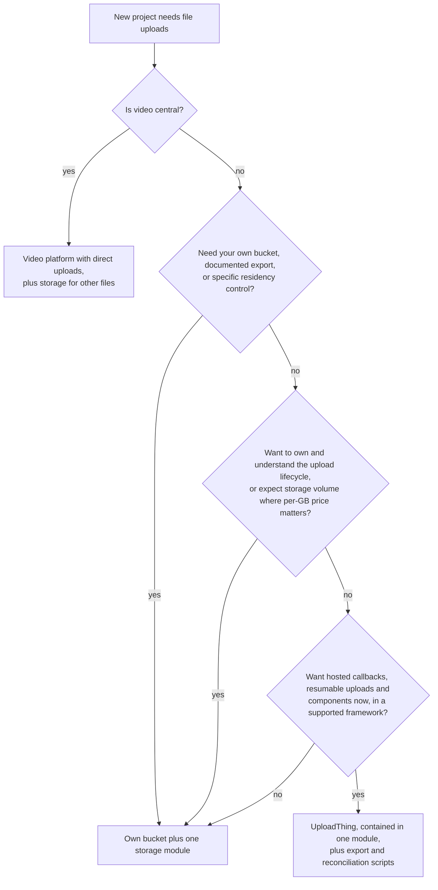

# 08 Decision: Own Bucket vs UploadThing (Solo TypeScript Monorepo, With Coding Agents)

Reading route: **8 of 8** · ~25 min · prev ← [[07 UploadThing Popularity - What the Evidence Shows]] · hub: [[_ Object Storage Hub]]

**Builds on:** [[04 Browser Uploads in Practice]] (mechanics), [[06 UploadThing - What It Actually Is]] (architecture), [[02 How S3 Became the Convention]] (S3-compatible, egress, lock-in).
**Visual companion:** the responsibility table in [Upload flows explained (HTML)](upload-flows-explained.html).

**Main sources:** [UploadThing pricing](https://uploadthing.com/pricing) · [UploadThing regions & ACL](https://docs.uploadthing.com/concepts/regions-acl) · [UploadThing outage report](https://docs.uploadthing.com/blog/incident-report-2024-09-10) · [R2 pricing](https://developers.cloudflare.com/r2/pricing/) · [R2 presigned URLs](https://developers.cloudflare.com/r2/api/s3/presigned-urls/) · [AWS presigned URLs](https://docs.aws.amazon.com/AmazonS3/latest/userguide/using-presigned-url.html) · [CloudFront origin access control](https://docs.aws.amazon.com/AmazonCloudFront/latest/DeveloperGuide/private-content-restricting-access-to-s3.html)

> [!info] Assumptions (your stack is unknown)
> A TypeScript monorepo: a web app (Next.js or similar), a server/API layer, a SQL database, maybe a mobile or admin app later. You're the only developer *and* the only operator. Coding agents write much of the code. The project is meant to last, and you've said you want to *understand* this field, not just ship past it. Change those assumptions and the answer can change; see "What could flip this" below.

> [!tip] My recommendation, for these assumptions
> **Lean towards your own bucket on an S3-compatible provider, with the storage code contained in one module you own.** Use direct browser uploads signed for one exact key, a DB row per file, a finalize-and-accept step, and lifecycle-based cleanup ([[04 Browser Uploads in Practice]]).
>
> **UploadThing is a legitimate production choice** when its documented guarantees fit your needs: hosted callbacks, resumable uploads, ready-made components across several frameworks, and private files on paid plans. You also have to accept UploadThing-managed storage without documented bring-your-own-bucket or bulk export. There's no universal winner. This is a judgment about total work, control and fit.

---

## Why I lean towards your own bucket here

1. **Your app owns the hard parts either way.** Authorization rules, DB records, deletion policy, content checks for risky types, and video processing are yours with UploadThing too ([[06 UploadThing - What It Actually Is]] §4). Your own bucket adds signing, CORS, finalize/accept, lifecycle rules and a sweep. That's real work, but bounded and well documented.
2. **Understanding is part of the goal.** Building that small lifecycle yourself teaches exactly the mechanics in notes 01–05, and you'll be able to debug it.
3. **Control and exit.** The bytes sit in an account you control, behind an API that several providers implement. With UploadThing, as documented today, there's no bulk export or bring-your-own-bucket, and region changes don't move existing files.
4. **Cost isn't decisive at small scale.** At 100 GB, UploadThing is $10/month against roughly one or two dollars of raw storage (prices dated 2026-10, table below). The gap grows in the hundreds of GB ($0.08/GB overage vs R2's $0.015/GB-month). It reverses in UploadThing's favor if you'd otherwise pay heavy egress, since UploadThing advertises no separate bandwidth charge.

## Reliability: who operates what (both sides)

Counting companies on a request path doesn't measure reliability, and one outage doesn't settle a comparison. What differs is **which parts you operate, which are operated for you, and what you can do when something breaks**:

- **Own bucket:** the provider operates storage (and a CDN if you add one), and providers do have outages ([S3 in 2017](https://aws.amazon.com/message/41926/)). *You* operate the sign, finalize and sweep endpoints, CORS, lifecycle rules and credentials, and you have to notice when they break. Recovery is in your hands: switch CDNs, copy data, fix your code.
- **UploadThing:** it operates ingest, callbacks, resumable uploads, storage and its CDN, which is work you no longer do or monitor. New uploads depend on its ingest servers plus your callback endpoint. Reads depend on its storage and CDN. Its 2024 incident made hosted file URLs unreachable for 53 minutes ([report](https://docs.uploadthing.com/blog/incident-report-2024-09-10)). Recovery for those paths depends on UploadThing.

For a solo developer, handing over work you'd do badly can be a reliability *gain*. Handing over parts you need to control can be a risk. Decide which describes your project.

## When UploadThing is the better call

- You want **hosted completion callbacks, resumable uploads and typed upload components** now, in a framework it supports, and prefer not to build or operate those pieces.
- You're **prototyping** or validating demand, and time matters more than control.
- **Private files on a paid plan** and **its region list** meet your needs.
- You don't need **your own bucket, documented export, or specific residency contracts**.
- Your app is reachable for callbacks, and you're fine configuring preview deploys and local tunnels ([FAQ](https://docs.uploadthing.com/faq)).

And when it fits less well:
- You need **your own bucket, documented export, or residency guarantees** for compliance or customers.
- **Video is core**: you'll need a video platform anyway ([[05 Photos, Documents and Video]]).
- You expect **large stored volumes** that make per-GB pricing matter. Where "large" starts depends on your budget; the price table below lets you compute it.

## What could flip this
- **Existing infrastructure:** already deep in AWS or Cloudflare makes your own bucket cheaper to adopt. A team that has never touched a cloud console might reasonably prefer a hosted service.
- **Compliance or contracts** (residency, retention, audit) favor storage you control, or a vendor whose terms you've actually reviewed.
- **Heavy video** points to a video platform, whatever you pick for other files.
- **Team growth:** more people means more value in fewer moving parts *you* operate. That cuts both ways.

## Side by side

| Dimension | Own bucket (S3-compatible) + one storage module | UploadThing |
|---|---|---|
| Setup | Provider account, bucket, CORS, scoped credentials, lifecycle rules | Account, token, file router |
| Code you own | Start-upload, accept, read and delete operations; sweep job; client upload helper | Router + middleware + `onUploadComplete`; delete calls; reconciliation |
| New-upload path depends on | Your server (sign + finalize) + storage provider | Your server (sign + callback) + UploadThing ingest |
| Read path depends on | Storage provider (+ your CDN, if any) | UploadThing storage/CDN (`ufs.sh`) |
| Upload-finished signal | You build finalize (or bucket events) | Built-in signed callback |
| Resumable / huge files | Add multipart or tus when needed | Built in |
| Private files | Presigned GET after your check. No plan gate; normal request and egress costs apply | Signed URLs; paid-plan feature |
| Size enforcement | POST policy (AWS) and/or finalize check | Signed size enforced at ingest |
| Content checks | Yours, at finalize/accept | Yours (SDK uses browser MIME; ingest behavior undocumented) |
| Egress | Provider-dependent (R2 lists free; AWS bills beyond its free tier) | Advertised as not separately billed (terms not reviewed) |
| Storage price (2026-10) | R2 $0.015/GB-mo; S3 a little over 2¢/GB | $10 / 100 GB, $25 / 250 GB, then $0.08/GB |
| Data location | Your choice of provider and region | Their region list; changing doesn't move files |
| Leaving | Copy objects to the new provider; recreate CORS, lifecycle and permissions; update endpoint, credentials and URL generation. The shared S3 core limits code changes | Script `listFiles` + download, re-upload, update stored keys and URLs, and rework the upload UI, router and callbacks |
| Local dev / previews | Works wherever the browser can reach the bucket | Callback needs a reachable URL (tunnel or bypass) |

## What coding agents change, and what they don't (judgment, not measurement)

**Likely to change (practical hypotheses):**
- **Implementation effort.** Presign, finalize and sweep code follows standard, publicly documented patterns. With clear rules, agents can probably draft it quickly. That's my expectation, not something measured here. Review it and test it in your own workflow.
- **Setup as code.** CORS and lifecycle rules can live in a script or config file instead of console clicks.

**Not changed:**
- **Operational ownership.** Someone has to notice a billing spike, rotate a leaked key, answer a deletion request, and fix a sweep job that quietly stopped. That's you, with either option.
- **Security judgment.** Plausible-looking code can trust `file.type`, sign week-long URLs, sign a prefix instead of a key, make a bucket public to fix a 403, or use user filenames as keys. It all works in testing.
- **Blast radius.** An agent holding production storage credentials can delete production data.

**Guardrails worth writing into your repo's agent instructions:**
- Storage code lives in one module. Nothing else imports the provider SDK.
- Keys are server-generated. Sign one exact key per pending row. Never use user filenames in keys.
- Upload URLs expire in minutes. Uploads are finalized: size checked, format sniffed for risky types, and content accepted into a key no browser was given.
- Buckets stay private. Public files go through a CDN with origin access, or a deliberately public prefix decided by you.
- Separate dev and prod buckets and credentials. Agents only get dev credentials. Prefer temporary, scoped credentials.
- Every file has a DB row. No code treats a bucket listing as the index.

## A small starting shape (own bucket)

```text
packages/storage/    ← the only code that imports the provider SDK
  uploads.ts         startUpload, acceptUpload
  reads.ts           readUrl
  deletes.ts         deleteFile
  config.ts          endpoint, bucket, credentials (temporary/scoped where possible)
packages/db/         files table + queries
apps/web/            upload UI: ask server → upload to returned URL → call complete
jobs/sweep           mark stale pending rows abandoned; retry stuck deletions
infra/bucket.json    CORS for your origins; lifecycle: expire incoming/ after 1 day, abort multipart after a few days
```

These are **app-specific operations, not a generic storage framework**:

```ts
// What your app does with files, in your own vocabulary
declare function startUpload(input: { ownerId: string; purpose: "avatar" | "document"; claimed: { name: string; size: number; type: string } })
  : Promise<{ fileId: string; upload: { url: string; method: "PUT" | "POST"; fields?: Record<string, string> } }> // signed for incoming/<fileId> only
declare function acceptUpload(fileId: string): Promise<"ready" | "rejected"> // validate and publish the same pinned/protected snapshot (note 04 §4)
declare function readUrl(fileId: string, viewerId: string): Promise<string> // authorization first, then a short-lived URL or a CDN URL
declare function deleteFile(fileId: string): Promise<void> // status=deleting → delete objects → status=deleted (retryable)
```

`files` table: `id`, `owner_id`, `purpose`, `status` (`pending | ready | rejected | deleting | deleted`), `upload_key`, `key` (accepted), `size`, `detected_type`, `original_name`, `created_at`.

**If you choose UploadThing instead**, `startUpload`/`acceptUpload` become its file router, middleware and `onUploadComplete`, and the client uses its components. Those shapes differ from the sketch above, so switching providers later means adapting the upload UI, server flow and callbacks, not just module internals. Keeping storage in one module is meant to concentrate that change in one place. It won't make it free. A generic multi-provider interface would be extra machinery you probably don't need.

### Which provider for your own bucket (short, not a catalogue)
- **Cloudflare R2:** attractive for publicly delivered files because it lists egress as free ([pricing](https://developers.cloudflare.com/r2/pricing/)). Documented gaps: no presigned POST (enforce size at finalize), no versioning via the S3 API, and presigned URLs only on the S3 API domain, not custom domains ([R2](https://developers.cloudflare.com/r2/api/s3/presigned-urls/)).
- **AWS S3:** the reference implementation. POST policies, versioning, event notifications, managed malware scanning, and CloudFront with origin access control for public delivery from a private bucket. Egress is billed beyond the free tier, so set an alert.
- **Others** (B2, Tigris…): fine if you stay within the common core from [[02 How S3 Became the Convention]] §5. Test what you rely on.

### How the answer shifts with your stack
- **Long-running server (not serverless):** proxying small uploads becomes viable and simpler ([[04 Browser Uploads in Practice]] §1). Go direct once request size or time limits bite.
- **Native mobile app:** the same authorize → sign → upload → finalize pattern applies. Native clients don't enforce browser CORS, but everything else (expiry, exact keys, acceptance) still matters. UploadThing also has an Expo package.
- **Edge runtimes:** whether a given AWS SDK module, credential provider or lighter signing library runs depends on the runtime. Check the modules you pick and test signing where your sign endpoint actually runs.

## Signals to add complexity later (illustrative thresholds)

| Signal | Add |
|---|---|
| Single-request uploads fail often (large files, bad networks) | Multipart (S3 API) or tus/resumable via a client library |
| Users share documents with others | Malware scanning; download-only serving from a separate domain |
| Thumbnails are slow or images heavy | Fixed-size variants at acceptance, or an optimizer with an allowlist |
| Video becomes a feature | A video platform with direct uploads; store its asset ID |
| Egress shows up on the bill | CDN caching with origin access (check it actually lowers cost), or a zero-egress provider |
| Data is irreplaceable | Versioning (S3) or a scheduled cross-provider copy |
| Acceptance makes finalize slow | Background job or queue after finalize |
| Customers ask where data lives | Region-pinned buckets per jurisdiction |

## If you choose UploadThing: five habits
1. Store **file keys or custom IDs** in your DB, not raw URLs. The docs say storage locations may change ([docs](https://docs.uploadthing.com/working-with-files)).
2. **Pick the region before real uploads.** Changing it later doesn't move existing files ([docs](https://docs.uploadthing.com/concepts/regions-acl)).
3. Keep UploadThing usage inside one module, apart from its UI components.
4. Keep and occasionally run an **export script** (`listFiles` → download → checksum), and a reconciliation that finds files with no DB row.
5. Still verify risky file types in `onUploadComplete`, and still handle deletion in your domain logic.

## The decision as a flowchart



## Takeaways
- Compare **total work, control and fit**, not SDK line counts. Both options leave authorization, DB records, deletion and content checks with you.
- Reliability isn't a company count. It's who operates which path and what you can do when it breaks.
- Agents may make the own-bucket glue cheaper to write (a hypothesis to test). They don't operate it for you.
- For a lasting project whose owner wants to understand the system, I lean towards **own bucket + one contained module**. UploadThing is a deliberate, defensible choice when its documented features fit and its unknowns don't matter for your project.

Back to [[_ Object Storage Hub]]
